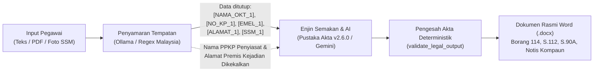

<div align="center">


<br /><br />


# i-UIP Nerus

**Platform Pintar Penguatkuasaan, Pengurusan Kertas Siasatan (IP), Semakan Pra-TPR & Notis Kompaun**  
*Unit Inspektorat dan Perundangan (UIP), Pejabat Kesihatan Daerah Kuala Nerus, Jabatan Kesihatan Negeri Terengganu*

> *"Satu Hati, Satu Tekad: Memacu Kecemerlangan Kesihatan Kuala Nerus"*

[](https://iuippkdkn.cloud.run)
[](data/legal_library/statutes_registry.json)
[](frontend/package.json)
[](backend/requirements.txt)
[](backend/core/database.py)
[](backend/tests/test_uip_command.py)

[Aplikasi Web](https://iuippkdkn.cloud.run) • [Modul Utama](#modul--ciri-utama) • [Pustaka Warta AGC](#pustaka-akta-warta-rasmi-agc-v260) • [Keselamatan & PDPA](#seni-bina-keselamatan--privasi-osa-1972--pdpa) • [Pemasangan Tempatan](#menjalankan-secara-tempatan) • [Deploy Cloud Run](deploy/CLOUD_RUN_DEPLOY.md)

</div>

---

## Mengenai i-UIP Nerus

**i-UIP Nerus** ialah aplikasi web responsif (Desktop & Telefon Pintar) yang dibina khusus untuk membantu **Penolong Pegawai Kesihatan Persekitaran (PPKP)**, **Pegawai Kesihatan Persekitaran (PKP)**, dan **Pegawai Penyiasat (IO)** menjalankan kerja penguatkuasaan kesihatan awam dengan pantas, tepat mengikut undang-undang terkini, dan bebas kesilapan teknikal.

Aplikasi ini menggabungkan **Enjin Perundangan Tertutup 2-Lapisan (`v2.6.0-closed-book-agc-pdf`)** berasaskan **20 fail PDF Warta Kerajaan Rasmi AGC** (`1,494` seksyen verbatim & `97` kesalahan berindeks), sokongan **Analisis AI Multimodal (Gemini)**, serta **Penyamaran Data Peribadi Tempatan (OSA 1972 & PDPA)** supaya setiap Notis Kompaun dan Kertas Siasatan (IP) sentiasa kemas sebelum dikemukakan kepada **Timbalan Pendakwa Raya (TPR)** atau didaftarkan di **Mahkamah Majistret**.

---

## Modul & Ciri Utama

| Modul | Fungsi Utama Untuk Pegawai Lapangan & Pejabat |
| :--- | :--- |
| **1. Tanya Pakar UIP (Keputusan 2-Cabang)** | Aliran keputusan tegas **2-Cabang** mengikut fakta di lokasi:<br>• **Cabang `TIADA_KESALAHAN`**: Menjelaskan sebab perbuatan tidak menyalahi akta (cth. pemilikan vape dalam beg tanpa bukti menghisap/membeli), langkah susulan pentadbiran/sekolah serta syarat bukti tambahan (`S.13(1)` / `S.13(3)`), tanpa menjana pertuduhan palsu.<br>• **Cabang `ADA_KESALAHAN`**: Paparan mengikut turutan kerja PPKP — **Punca Kuasa** (seksyen kesalahan, hukuman, status kompaun & peringatan Akta 611 jika OBD) → **Cadangan Tindakan Segera** → **SOP Lapangan Bernombor** → tab **Barang Bukti & Perkara Wajib Dibuktikan**, **Draf Pertuduhan**, dan **Teks Asal Akta**, berserta **Koleksi Soalan & Jawapan Pakar** yang disamarkan PDPA. |
| **2. Direktori Akta & Kesalahan** | Carian pantas **97 kesalahan berindeks** dan **1,494 seksyen verbatim** daripada **22 akta/peraturan** merangkumi tab **Senarai Kesalahan**, **Teks Penuh Akta**, **Akta Dimansuhkan**, dan **Admin Warta** *(akaun Pentadbir sahaja)* untuk muat naik PDF Warta baharu dan pengesahan status (`DRAFT_PENDING_REVIEW` → `VERIFIED_AGC`). |
| **3. Penyemak & Penjana Notis Kompaun** | Imbas foto **Sijil SSM / Notis** (OCR AI), isi borang berpandu, dan semak **10 perkara wajib (`K01–K10`)** secara automatik:<br>• Menyekat kesalahan **tidak boleh dikompaun** mengikut Warta (`S.3(1), 7(1), 9(1), 10(1), 13(1)` Akta 852; `S.13(1), 13B, 11(2)` Akta 281; `S.8(8)` Akta 154; `S.12(1), 22(a)` Akta 342).<br>• Mengesahkan had amaun & tempoh bayaran rasmi (**30 hari** Akta 852; **14 hari** Akta 154 & Akta 281), menolak julat amaun, menyokong **MyKad** (dengan semakan tarikh kalendar & ketidakselarasan umur OBD `<18`), **No. Pasport** dan **No. SSM**.<br>• Eksport **Notis Kompaun Word (`.docx`)** lengkap dengan kepala Akta, blok tandatangan PPKP/OKS/Saksi dan maklumat bayaran **Unit Hasil**. |
| **4. Semak Fail IP (Audit 20 Kriteria Pra-TPR)** | Muat naik **PDF / Word IP, imej/PDF imbasan bukti** *(diproses melalui OCR multimodal)*, Carian SSM atau catatan kes untuk **Audit 20 Kriteria Pra-TPR**: mengesan salah petik seksyen *(cth. S.16(1)/S.38/S.44 Akta 852, P.30 vs P.31(2) tifoid, S.8(2) vs S.8(8) Akta 154, Akta 514)*, percanggahan tarikh/masa, peringatan serahan 10 hari jelas Perakuan Juruanalisis (`S.19(2)` Akta 281), status **Sijil Seksyen 90A(2)**, semakan susunan fail **7 Bahagian (`A–G`)**, dan pautan terus ke bahagian suntingan yang berkaitan. |
| **5. Bina Fail IP & Eksport `.docx`** | Sunting Kertas Siasatan dalam 4 bahagian kemas (*Pertuduhan & Saman*, *Minit, Fakta & Kronologi*, *Saksi, Eksibit & S.90A*, *Rakaman S.112 & Diari*). Eksport **Pakej Fail IP Lengkap (Indeks 7 Bahagian `A–G`)** atau dokumen individu (**Borang 114** termasuk sokongan pertuduhan tambahan `S.163` KTJ, **Saman 111**, **Permohonan Izin Mendakwa / Keizinan Pendakwa Raya**, **Diari Siasatan S.119**, **Rakaman S.112**, **Sijil S.90A(2)**) ke format rasmi Microsoft Word **`.docx`**. |
| **6. Buku Panduan, Profil SSPA & Daftar Kes** | Panduan digital 4 fasa operasi UIP, panduan ringkas 4 akta teras, formula **5W1H Borang 114**, senarai **10 kesilapan utama PPKP**, log masuk **Google OAuth 2.0** atau e-mel rasmi (dengan sandaran automatik jika skrip Google disekat rangkaian pejabat), gred **SSPA** (`U5–U14`, `UD9–UD14`, `C9–C14`), serta Daftar Kes PKD yang diasingkan mengikut pemilik kes. |

---

## Pustaka Akta Warta Rasmi AGC (`v2.6.0`)

Semua rujukan, pengesahan petikan (`validate_legal_output` / `validateLegalOutput`), dan penyemakan unsur kesalahan berpaksikan fail PDF Warta Kerajaan Persekutuan dalam [`data/akta/`](data/akta) yang diindeks ke dalam pustaka 2-lapisan [`data/legal_library/`](data/legal_library) (`22` akta/peraturan, `1,494` seksyen verbatim, `97` kesalahan berindeks, `6` peruntukan dimansuhkan/disekat):

| Kelompok Akta | Dokumen Warta AGC Berindeks (`data/akta/`) | Skop Penguatkuasaan & Pindaan Terkini |
| :--- | :--- | :--- |
| **Akta 852 & 8 Peraturan/Perintah 2024** | `AKTA_852.pdf`, `P.U. (A) 257/2024` hingga `P.U. (A) 264/2024` | Akta Kawalan Produk Merokok Demi Kesihatan Awam 2024 — kawasan larangan (`S.16(2)`), OBD `<18` (`S.17(1)`, `S.13(3)`), larangan pameran/iklan/jualan OBD (`S.7(1)`, `S.9(1)`, `S.10(1)`, `S.13(1)` — **tidak boleh dikompaun**, sitaan & IP berserta `S.49` perbadanan & `S.114A` Akta 56), Notis `S.47`, dan Pengkompaunan `S.48` (`P.U. (A) 259/2024`, tempoh **30 hari**). |
| **Akta 281, Pindaan A1702, PPKM 2009 & PPM 1985** | `AKTA_281.pdf`, `AKTA_281_PINDAAN_A1702_2024.pdf`, `PPKM_2009.pdf`, `PPM_1985.pdf` | Akta Makanan 1983 (penutupan premis `S.11`, makanan memudaratkan `S.13(1)`/`S.13B`, serahan perakuan juruanalisis `S.19(2)` 10 hari jelas, kompaun `S.32B`/`S.33` tempoh **14 hari**), PPKM 2009 (`P.30` LPM, `P.31(1)/(2)` antitifoid, `P.32`), dan PPM 1985 (`P.14(9)`, `P.397(2)`). |
| **Akta 154** | `AKTA_154.pdf` | Akta Pemusnahan Serangga Pembawa Penyakit 1975 — pembiakan serangga pembawa penyakit (`S.13(1)`), ingkar perintah bertulis (`S.8(8)` — tidak boleh dikompaun), dan kompaun `S.25` (**maksimum RM500**, tempoh **14 hari**). |
| **Akta 342, Pindaan A1742 (2025) & Kompaun 2025** | `AKTA_342.pdf`, `AKTA_342_PINDAAN_A1742_2025.pdf`, `AKTA_342_PERATURAN_KOMPAUN_2025.pdf` | Akta Pencegahan dan Pengawalan Penyakit Berjangkit 1988 dengan **Pindaan Akta A1742** (`S.24`: denda hingga **RM10,000** atau **2 tahun penjara** bagi individu; hingga **RM100,000** bagi pertubuhan perbadanan) serta pengkompaunan `S.25` di bawah **`P.U. (A) 139/2025`**. |
| **Akta Prosedur, Keterangan & Kanak-Kanak** | `AKTA_593.pdf`, `AKTA_56.pdf`, `AKTA_611.pdf` | **Akta 593 (KTJ):** Percakapan `S.112`, Diari `S.119`, Saman `S.111`, Pertuduhan berasingan `S.163`, Izin Mendakwa `S.376`/`S.377(b)`. **Akta 56:** Sijil Dokumen Komputer `S.90A(2)` & anggapan penerbitan digital `S.114A`. **Akta 611:** Perlindungan identiti & tatacara kanak-kanak (`<18` tahun). |
| **Peruntukan Dimansuhkan / Disekat** | `repealed_and_blocked_provisions.json` | Sekatan automatik ke atas **PPKHT 2004** (`P.U. (A) 324/2004` — dimansuhkan 1 Okt 2024) dan **Ordinan Darurat 2021** (`P.U. (A) 82/2021` — tamat tempoh). |

> **Kawalan Pengesahan Warta:** Semua rekod yang dijana secara automatik bermula dengan status `DRAFT_PENDING_REVIEW` (`verified_by_admin: false`) sehingga disahkan secara rasmi oleh Pentadbir melalui tab **Admin Warta** atau skrip CLI [`scripts/ingest_statute.py`](scripts/ingest_statute.py). Rujuk juga [`data/akta/PANDUAN_MUAT_NAIK_WARTA_AGC.md`](data/akta/PANDUAN_MUAT_NAIK_WARTA_AGC.md).

---

## Seni Bina Keselamatan & Privasi (OSA 1972 & PDPA)

Aplikasi ini menerapkan perlindungan berbilang lapis untuk melindungi data kes, identiti OKS/saksi/pesakit, serta integriti sesi pegawai:



* **Penyamaran Data Peribadi Tempatan:** Menutup Nama OKT/Saksi, No. K/P, Pasport, nombor telefon, No. SSM, alamat e-mel bukan `@moh.gov.my`, dan alamat kediaman/pesakit sebelum dihantar ke AI awan, sambil mengekalkan nama Pegawai Penyiasat (IO) dan alamat premis kejadian.
* **Pengasingan Fail Kes (Anti-IDOR):** Setiap fail kes diikat kepada `owner_user_id` pemilik sesi — pegawai hanya boleh melihat, menyunting dan memadam kes miliknya sendiri (serta merujuk kes contoh berlabel `kes-akta-*`), manakala cubaan akses rentas pengguna disekat `403 Forbidden`.
* **Keselamatan Sesi & Pengesahan:** Token sesi disimpan dalam bentuk cincangan **SHA-256** dengan tempoh luput **30 hari**, pengesahan `aud`/`azp` bagi Google OAuth, penguncian identiti pegawai daripada sesi sah pelayan, had muat naik **15 MB**, dan dasar CORS khusus domain yang dibenarkan.
* **Mod Rujukan Tempatan (Tanpa Kunci AI):** Jika `GEMINI_API_KEY` belum ditetapkan atau talian AI awan terganggu, sistem kekal beroperasi menggunakan **Pustaka Akta v2.6.0 Tempatan** untuk Tanya Pakar 2-Cabang, Direktori Akta, Penyemak Kompaun, Audit IP 20 Kriteria, penyamaran data, dan eksport `.docx`.
* **Kawalan Akses Pentadbir & Arkib:** Konsol Pembangun, Tetapan Sistem, muat naik Warta AGC, dan Arkib Persendirian (`dev-vault`) hanya boleh diakses oleh akaun pentadbir berdaftar, dengan `DEV_ARCHIVE_LOCAL_ENABLED=false` sebagai lalai pada produksi Cloud Run.

---

## Susunan Teknologi (*Tech Stack*)

* **Frontend:** Next.js 15 (`output: "standalone"`), React 19, TypeScript, Tailwind CSS v3, Lucide React
* **Backend API:** FastAPI, Uvicorn, Pydantic v2, PyMuPDF (`pymupdf` / `fitz`), `python-docx`, `httpx`
* **Enjin Perundangan & AI:** Pustaka Perundangan 2-Lapisan (`v2.6.0-closed-book-agc-pdf`), ChromaDB + BM25, Google GenAI SDK (`gemini-decision-1`, `gemini-4-hydrogen`, `gemini-4-argon` / sandaran standard), Ollama (`gemma3:12b`)
* **Pangkalan Data & Storan:** Sokongan dwi-mod **PostgreSQL (Neon)** untuk produksi Cloud Run atau **SQLite WAL** untuk pembangunan tempatan, serta storan objek serasi S3 (`Neon Object Storage`)
* **Infrastruktur Produksi:** Container gabungan Multi-Stage Docker + Nginx Reverse Proxy (`PORT=8080`) di Google Cloud Run (`https://iuippkdkn.cloud.run`)

---

## Struktur Projek

```text
i-uip-pkdkn/
├── backend/
│   ├── core/               # Konfigurasi (.env), pangkalan data SQLite/PostgreSQL (IDOR & SHA-256), redactor PDPA, penghala AI
│   ├── rag/                # Enjin perundangan tertutup 2-lapisan (legal_engine.py) & stor statutori (statutory_store.py)
│   ├── services/           # Pakar UIP 2-Cabang, Auditor IP 20 Kriteria, Penyemak Kompaun, Penjana .docx (A-G), Dev Vault
│   ├── tests/              # Suite ujian automatik Pytest (27 ujian menyeluruh: keselamatan, undang-undang, kompaun, .docx)
│   └── main.py             # Pintu masuk REST API FastAPI
├── frontend/
│   ├── public/images/      # Aset logo rasmi i-UIP Nerus & PKD Kuala Nerus
│   └── src/
│       ├── app/            # Halaman utama, susun atur responsif & gaya global
│       ├── components/     # 17 komponen UI Desktop & Telefon Pintar (Pakar UIP, Direktori Akta, Kompaun, Audit IP, Editor IP, dll.)
│       └── lib/            # Klien API dengan tamat masa (AbortController), pengesah akta (legalValidator.ts) & jenis TypeScript
├── data/
│   ├── akta/               # 20 fail PDF Warta Kerajaan Rasmi AGC + panduan muat naik & rujukan sumber
│   └── legal_library/      # Indeks JSON 2-lapisan (statutes_registry, statute_sections_verbatim, master_offences_matrix, repealed)
├── scripts/                # Skrip CLI pengindeksan PDF Warta AGC (ingest_statute.py)
├── deploy/                 # Konfigurasi Nginx, skrip start.sh & panduan Google Cloud Run
├── training/               # Utiliti penyediaan set data & fine-tuning model tempatan
├── Dockerfile              # Binaan produksi 1-servis (Nginx + FastAPI + Next.js Standalone + PyMuPDF)
└── .env.example            # Templat pemboleh ubah persekitaran
```

---

## Menjalankan Secara Tempatan

### Prasyarat
* **Python 3.11+** (disyorkan menggunakan persekitaran maya `.venv`)
* **Node.js 20+** dan `npm`

### 1. Konfigurasi Persekitaran (`.env`)
Salin templat konfigurasi dan lengkapkan pemboleh ubah yang diperlukan (pilihan: `GEMINI_API_KEY` untuk Analisis AI Awan dan `DATABASE_URL` jika menyambung ke PostgreSQL Neon):

```bash
# Linux / macOS
cp .env.example .env
```

```powershell
# Windows (PowerShell)
Copy-Item .env.example .env
```

### 2. Pasang Kebergantungan & Hidupkan Backend (FastAPI)

```bash
# Linux / macOS
python3 -m venv .venv
.venv/bin/pip install -r backend/requirements.txt
.venv/bin/uvicorn backend.main:app --reload --port 8000
```

```powershell
# Windows (PowerShell)
python -m venv .venv
.\.venv\Scripts\python.exe -m pip install -r backend\requirements.txt
.\.venv\Scripts\python.exe -m uvicorn backend.main:app --reload --port 8000
```

### 3. Pasang Kebergantungan & Hidupkan Frontend (Next.js)

```bash
npm --prefix frontend install
npm --prefix frontend run dev
```

Buka pelayar web di `http://localhost:3000`. Untuk mod produksi tempatan, jalankan `npm --prefix frontend run build` diikuti `npm --prefix frontend run start`.

---

## Ujian, Indeks Warta & Pengesahan Kualiti

Jalankan ujian penuh backend dan binaan frontend sebelum membuat *deployment*:

```bash
# 1. Suite ujian penuh (27 ujian: API, Pustaka Akta v2.6.0, Anti-IDOR, Kompaun, Audit IP & .docx)
.venv/bin/python -m pytest -v backend/tests/test_uip_command.py

# 2. Pengesahan TypeScript, lint & binaan produksi Next.js
NEXT_TELEMETRY_DISABLED=1 npm --prefix frontend run build

# 3. (Pilihan) Indeks semula PDF Warta Rasmi AGC secara CLI
.venv/bin/python scripts/ingest_statute.py --file data/akta/AKTA_852.pdf --statute-id AKTA_852
```

---

## Deployment Produksi (Google Cloud Run & Neon PostgreSQL)

Projek ini beroperasi sebagai **1 servis Cloud Run gabungan** menggunakan [`Dockerfile`](Dockerfile) dan [`deploy/start.sh`](deploy/start.sh) (Nginx menghalakan `/api/*` ke FastAPI dan `/*` ke Next.js secara *same-origin*).

* Rujuk panduan langkah demi langkah lengkap di **[`deploy/CLOUD_RUN_DEPLOY.md`](deploy/CLOUD_RUN_DEPLOY.md)**.
* Pastikan `DATABASE_URL` (PostgreSQL Neon) ditetapkan di **Variables & Secrets** Cloud Run supaya akaun pegawai, fail kes dan rekod kekal terpelihara. Sahkan pelayan aktif melalui:
  * `GET /api/health` → `{"status":"ok","db":"postgres"}`
  * `GET /api/status` → memaparkan nama revisi Cloud Run terkini dan `statute_library_version: "2.6.0-closed-book-agc-pdf"`.

---

## Penalaan Model Tempatan (Pilihan — `training/`)

Bagi fasiliti yang ingin melatih penyesuaian bahasa tempatan secara luar talian:

```bash
.venv/bin/python training/prepare_dataset.py --input-dir ./arkib_ip --output ./training/uip_dataset.jsonl
.venv/bin/python training/finetune_unsloth.py --dataset ./training/uip_dataset.jsonl
```

---

<div align="center">

Dibangunkan oleh **[g.dev/syrzy](https://g.dev/syrzy)** untuk **Unit Inspektorat dan Perundangan (UIP)**  
**Pejabat Kesihatan Daerah Kuala Nerus, Terengganu**

</div>
