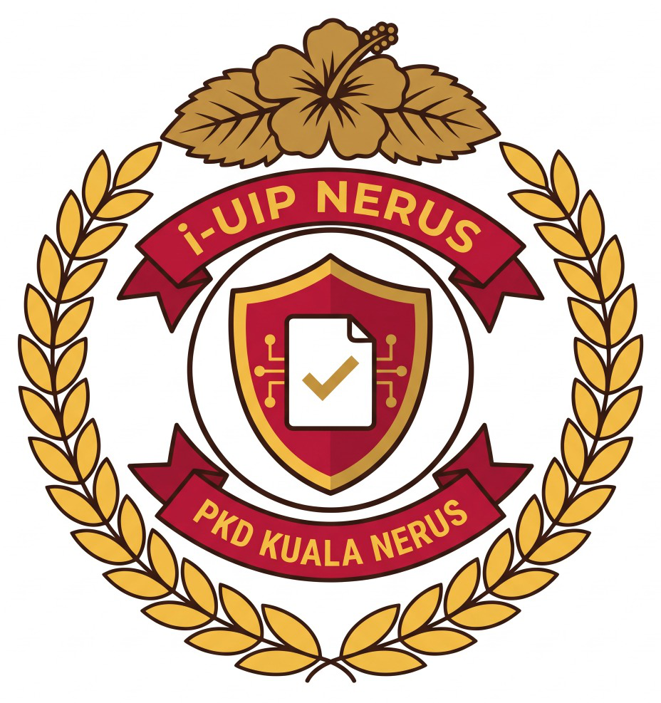
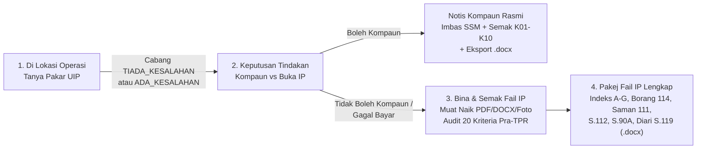
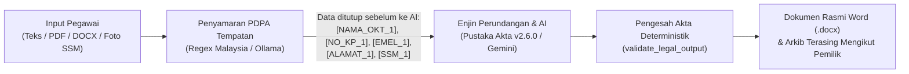

<div align="center">


<br /><br />


# i-UIP Nerus

**Pembantu Digital Pintar Penguatkuasaan Kesihatan Awam, Pengurusan Kertas Siasatan (IP), Semakan Pra-TPR & Notis Kompaun**

*Ciptaan **[syrzy](https://g.dev/syrzy)** — Berpaksikan amalan terbaik Unit Inspektorat dan Perundangan (UIP) PKD Kuala Nerus dan dibina siap siaga untuk Pegawai Penguat Kuasa Kesihatan Awam (PPKP, PKP & IO) di **seluruh Malaysia** (13 Negeri & 3 Wilayah Persekutuan).*

> *"Satu Hati, Satu Tekad: Memacu Kecemerlangan Kesihatan"*

[](https://iuippkdkn.cloud.run)
[-0d9488?style=for-the-badge)](#kesiapsiagaan-seluruh-malaysia-13-negeri--3-wilayah-persekutuan)
[](data/legal_library/statutes_registry.json)
[](backend/tests/test_uip_command.py)
<br />
[](frontend/package.json)
[](backend/requirements.txt)
[](backend/core/database.py)
[](https://g.dev/syrzy)

[Buka Aplikasi](https://iuippkdkn.cloud.run) • [Apakah i-UIP Nerus?](#apakah-sebenarnya-i-uip-nerus) • [4 Ruang Kerja Utama](#4-ruang-kerja-utama--modul-teras) • [Liputan Seluruh Malaysia](#kesiapsiagaan-seluruh-malaysia-13-negeri--3-wilayah-persekutuan) • [Pustaka Warta AGC](#pustaka-akta-warta-rasmi-agc-v260) • [Keselamatan & PDPA](#seni-bina-keselamatan--privasi-osa-1972--pdpa) • [Pemasangan Tempatan](#menjalankan-secara-tempatan)

</div>

---

## Apakah Sebenarnya i-UIP Nerus?

**i-UIP Nerus** ialah sebuah platform web pintar (*mobile-first* & desktop) ciptaan **[syrzy](https://g.dev/syrzy)** yang dibangunkan khas bagi memperkasa kerja harian **Penolong Pegawai Kesihatan Persekitaran (PPKP)**, **Pegawai Kesihatan Persekitaran (PKP)**, dan **Pegawai Penyiasat (IO)** di bawah **Unit Inspektorat dan Perundangan (UIP), Kementerian Kesihatan Malaysia (KKM)**.

Dalam operasi penguatkuasaan kesihatan awam di Malaysia, satu kesilapan teknikal yang kecil boleh memberi kesan besar — tersalah petik seksyen atau merujuk peraturan yang telah dimansuhkan (seperti PPKHT 2004), menawarkan kompaun bagi kesalahan yang *tidak boleh dikompaun*, melebihi had kompaun statutori, tersasar had masa pendakwaan, atau tertinggal dokumen pembuktian mandatori (seperti Sijil Seksyen 90A Akta Keterangan 1950 atau Izin Mendakwa Pendakwa Raya). Kesilapan ini lazimnya menyebabkan Kertas Siasatan (IP) dipulangkan dengan kuiri oleh **Timbalan Pendakwa Raya (TPR)** atau ditolak di **Mahkamah Majistret**.

**i-UIP Nerus** dibina dari perspektif sebenar pegawai lapangan untuk menyelesaikan cabaran tersebut dari awal hingga akhir:

| Dimensi | Ringkasan Untuk Audiens |
| :--- | :--- |
| **Siapa Penggunanya?** | PPKP, PKP, Pegawai Penyiasat (IO), Pegawai Pendakwa & Ketua UIP di seluruh **PKD (Semenanjung)**, **PKK (Sabah)**, **PKB (Sarawak)**, **JKWPKL&P**, dan **JKWPL**. |
| **Apa Masalah Yang Diselesaikan?** | Menghapuskan tekaan undang-undang di lokasi, mencegah notis kompaun *ultra vires*, mempercepat penyediaan draf Kertas Siasatan lengkap 7 Bahagian (`A–G`), serta mengurangkan kuiri teknikal sebelum fail diserahkan kepada TPR. |
| **Apa Keunikan Utama?** | Menggunakan **Enjin Perundangan Tertutup 2-Lapisan (`v2.6.0-closed-book-agc-pdf`)** berasaskan **20 fail PDF Warta Kerajaan Rasmi AGC** (`1,494` seksyen verbatim & `97` kesalahan berindeks) yang mengesahkan setiap petikan secara deterministik — **AI dilarang mereka seksyen palsu**, dan data sensitif disamarkan dahulu sebelum keluar ke AI awan. |
| **Boleh Guna Di Mana?** | Terus melalui pelayar **telefon pintar di lapangan (`≥360px`)** atau **komputer pejabat**, serta kekal berfungsi menggunakan enjin rujukan tempatan (**RM0.00**) walaupun tanpa kunci AI awan. |

---

## Aliran Kerja Hujung-ke-Hujung



---

## 4 Ruang Kerja Utama & Modul Teras

Antaramuka aplikasi disusun ringkas kepada **4 ruang kerja utama** yang seragam pada bar atas desktop dan bar bawah telefon pintar:

| Ruang Kerja / Modul | Keupayaan Utama Untuk Pegawai Lapangan & Pejabat |
| :--- | :--- |
| **1. Tanya Pakar UIP**<br>*(Keputusan 2-Cabang & Mod Mendalam AI)* | • **Mod Pantas (Pustaka AGC Tempatan)** & **Semakan Mendalam dengan AI (Gemini)** pada setiap soalan lapangan.<br>• **Keputusan 2-Cabang Tegas**:<br>&nbsp;&nbsp;– **`TIADA_KESALAHAN`**: Menjelaskan sebab perbuatan tidak menyalahi akta (cth. vape di dalam beg tanpa bukti menghisap/membeli, atau bekas takungan air tanpa larva Aedes), langkah susulan pentadbiran, serta bukti tambahan yang perlu dikumpul — **tanpa menjana pertuduhan palsu**.<br>&nbsp;&nbsp;– **`ADA_KESALAHAN`**: Menyusun jawapan mengikut turutan kerja PPKP: **Punca Kuasa** (seksyen kesalahan, hukuman, kelayakan kompaun & peringatan **Akta 611** jika OBD `<18`) → **Cadangan Tindakan Segera** → **SOP Lapangan Bernombor** → **Barang Bukti & Unsur Wajib Dibuktikan**, **Draf Pertuduhan**, dan **Teks Asal Akta Verbatim**.<br>• **Koleksi Q&A Terkumpul & Pintar Polariti**: Menjimatkan masa pegawai dengan memadankan soalan terdahulu yang telah disahkan sambil mengekalkan kata nafi (`tidak`/`tiada`/`belum`/`bukan`/`tanpa`) agar kes berlawanan fakta tidak tersalah padan. |
| **2. Direktori Akta & Admin Warta** | • Carian pantas **97 kesalahan berindeks** dan **1,494 seksyen verbatim** daripada **22 akta/peraturan** merangkumi tab **Senarai Kesalahan**, **Teks Penuh Akta**, **Akta Dimansuhkan**, dan **Admin Warta** *(akaun Pentadbir sahaja)*.<br>• Menyokong carian dwibahasa **BM → EN** bagi akta rujukan bahasa Inggeris (**Akta 593 KTJ** & **Akta 56 Akta Keterangan 1950**), muat naik PDF Warta AGC baharu, dan kawalan pengesahan rasmi (`DRAFT_PENDING_REVIEW` → `VERIFIED_AGC`). |
| **3. Notis Kompaun Rasmi**<br>*(Imbas Foto SSM & Semakan K01–K10)* | • Ambil atau muat naik **foto Sijil SSM / PDF / DOCX / TXT** (had 15 MB) untuk bacaan butiran automatik (OCR AI) serta pilihan **kesalahan lazim 1-klik**, dengan nama pegawai & No. Kad Kuasa terisi automatik daripada profil.<br>• **Semakan 10 Perkara Wajib (`K01–K10`)** dengan senarai putih ketat mengikut Warta:<br>&nbsp;&nbsp;– Menyekat kesalahan **tidak boleh dikompaun** (**Akta 852**: hanya `S.13(3), S.16(2), S.17(1), S.18(1)` boleh kompaun; **Akta 342**: hanya `S.10(2), S.11(5), S.21A(3), S.22(b)/(c)/(d)`; **Akta 281**: menyekat `S.11, S.13, S.13A, S.13B, S.13C, S.14–17`; **Akta 154**: menyekat `S.8(8), S.20, S.21`).<br>&nbsp;&nbsp;– Mengesahkan had amaun (**Akta 154** maks RM500; **PPKM 2009 P.32** maks RM500; **Akta 342 / A1742** maks RM5,000 individu / RM50,000 perbadanan), tempoh bayaran (**30 hari** Akta 852; **14 hari** Akta 154, 281 & 342), membezakan **12 digit MyKad** (termasuk semakan kalendar & umur OBD `<18`) daripada **12 digit No. SSM**, serta eksport **Notis Kompaun `.docx`** lengkap dengan ungkapan keizinan bertulis Pendakwa Raya. |
| **4. Fail IP: Audit 20 Kriteria Pra-TPR** | • Muat naik fail **PDF, Word `.docx` (termasuk kandungan jadual), `.txt` atau imej bukti** untuk semakan **20 Kriteria Pra-TPR** secara automatik.<br>• Mengesan salah petik seksyen, percanggahan tarikh/masa, penafian klausa (*"tiada Sijil 90A"*, *"belum diperoleh izin mendakwa"*), keperluan **Izin Mendakwa (C14)** (`S.41` Akta 852, `S.32A` Akta 281, `S.22A` Akta 154, `S.23` Akta 342), **serahan 10 hari jelas Perakuan Juruanalisis `S.20(ii)`**, **had masa pendakwaan `S.19(2)` (150 hari) & `S.19(1A)` (90 hari import)**, kelengkapan **Sijil `S.90A(2) & (3)(a)`**, serta susunan fail **7 Bahagian (`A–G`)** dengan pautan terus ke ruangan suntingan. |
| **5. Bina Fail IP & Eksport Word (`.docx`)** | • Editor berstruktur 4 bahagian (*Pertuduhan & Saman*, *Minit, Fakta & Kronologi*, *Saksi, Eksibit & S.90A*, *Rakaman S.112 & Diari*).<br>• Eksport **Pakej Fail IP Lengkap (Indeks 7 Bahagian `A–G`)** atau muat turun berasingan (**Borang 114** termasuk sokongan korporat & pertuduhan tambahan `S.163` KTJ, **Saman Mahkamah 111**, **Permohonan Izin Mendakwa**, **Diari Siasatan `S.119` SULIT `S.119(2)`**, **Rakaman `S.112` lengkap perakuan `S.112(4)–(5)` & ruang cap ibu jari**, serta **Sijil `S.90A(2) & (3)(a)` lengkap KEW.PA**). Aksara kawalan XML daripada PDF ditapis automatik agar eksport `.docx` tidak pernah rosak. |
| **6. Fail Saya, Profil SSPA & Buku Panduan** | • Pendaftaran & log masuk **Google OAuth 2.0** atau e-mel rasmi dengan profil gred **SSPA** (`U5–U14`, `UD9–UD14`, `C9–C14`), Daftar Fail Kes peribadi (`ip-*`), buku panduan digital 4 fasa operasi UIP, formula **5W1H Borang 114**, dan senarai **10 kesilapan lazim PPKP**. |

---

## Kesiapsiagaan Seluruh Malaysia (13 Negeri & 3 Wilayah Persekutuan)

Walaupun namanya membawa warisan inisiatif awal di Kuala Nerus, **i-UIP Nerus kini direka bentuk secara neutral dan sedia digunakan oleh setiap pejabat kesihatan di seluruh Malaysia**:

- **Pilihan Penuh 16 JKN / JKWP:** Pendaftaran dan profil menyokong kesemua 13 Jabatan Kesihatan Negeri dan 3 Jabatan Kesihatan Wilayah Persekutuan (`MALAYSIA_JKN_OPTIONS`).
- **Tatanama Pejabat Mengikut Wilayah:** Mengenal pasti dan menormalkan **PKD** (Pejabat Kesihatan Daerah — Semenanjung), **PKK** (Pejabat Kesihatan Kawasan — Sabah), **PKB** (Pejabat Kesihatan Bahagian — Sarawak), **JKWPKL&P**, dan **JKWPL** secara automatik melalui [`backend/core/malaysia_offices.py`](backend/core/malaysia_offices.py).
- **Bidang Kuasa Saman Mahkamah 111 Dinamik:** Menjana pengepala rasmi yang sah mengikut negeri kes — **`NEGERI SABAH, MALAYSIA`**, **`NEGERI SARAWAK, MALAYSIA`**, **`WILAYAH PERSEKUTUAN LABUAN, MALAYSIA`**, atau **`NEGERI-NEGERI TANAH MELAYU`** (tiada lagi pengepala Semenanjung/Selangor yang terkunci bagi kes Borneo).
- **Auto-Isi Profil Pegawai:** Nama pegawai, No. Kad Kuasa KKM, pejabat kesihatan, alamat pejabat, Mahkamah Majistret tempatan, nombor tauliah `S.377(b)` KTJ, dan spesifikasi perkakasan Sijil `S.90A` diisi automatik ke dalam draf IP dan Notis Kompaun.

---

## Pustaka Akta Warta Rasmi AGC (`v2.6.0`)

Semua analisis, penyemakan unsur kesalahan, dan pengesahan petikan (`validate_legal_output` di backend & `legalValidator.ts` di frontend) berpaksikan **20 fail PDF Warta Kerajaan Persekutuan** dalam [`data/akta/`](data/akta) yang diindeks ke dalam pustaka 2-lapisan [`data/legal_library/`](data/legal_library) (**22** akta/peraturan, **1,494** seksyen verbatim, **97** kesalahan berindeks, **6** peruntukan dimansuhkan/disekat):

| Kelompok Akta | Dokumen Warta AGC Berindeks (`data/akta/`) | Skop Penguatkuasaan & Ketepatan Statutori |
| :--- | :--- | :--- |
| **Akta 852 & 8 Peraturan/Perintah 2024** | `AKTA_852.pdf`, `P.U. (A) 257/2024` hingga `P.U. (A) 264/2024` | Akta Kawalan Produk Merokok Demi Kesihatan Awam 2024 — kawasan larangan (`S.16(2)` & Jadual `P.U. (A) 257/2024`), kewajipan papan tanda pemilik premis (`S.18(1)(a)` & `P.U. (A) 258/2024`), OBD `<18` (`S.17(1)`, `S.13(3)`), kesalahan tidak boleh kompaun (`S.7(1)/(2)`, `S.9(1)`, `S.10(1)/(2)`, `S.13(1)` — sitaan & IP berserta `S.49` perbadanan & `S.114A` Akta 56), Notis `S.47`, Izin Mendakwa `S.41`, dan Pengkompaunan `S.48(2)` (`P.U. (A) 259/2024`, tempoh **30 hari**). |
| **Akta 281, Pindaan A1702, PPKM 2009 & PPM 1985** | `AKTA_281.pdf`, `AKTA_281_PINDAAN_A1702_2024.pdf`, `PPKM_2009.pdf`, `PPM_1985.pdf` | Akta Makanan 1983 — perintah tutup premis (`S.11`, tanpa subseksyen `(2)`), makanan memudaratkan (`S.13(1)`), benda asing/busuk (`S.13A(1)/(2)` dipisahkan daripada makanan diaduk `S.13B`), serahan Perakuan Juruanalisis **10 hari jelas (`S.20(ii)`)**, had masa pendakwaan **150 hari (`S.19(2)`)** & **90 hari import (`S.19(1A)`)**, Izin Mendakwa `S.32A`, kompaun `S.32B`/`S.33` (**14 hari**); **PPKM 2009** (`P.8`, `P.11`, `P.30` LPM, `P.31(1)/(3)` antitifoid, `P.32` had kompaun RM500); **PPM 1985** (`P.14(9)(a)`, `P.397(2)`). |
| **Akta 154** | `AKTA_154.pdf` | Akta Pemusnahan Serangga Pembawa Penyakit 1975 — pembiakan serangga pembawa penyakit (`S.13(1)`), ingkar perintah bertulis (`S.8(8)`), menghalang/enggan kerjasama pemeriksaan & semburan kabus (`S.20`, `S.21` — tidak boleh dikompaun), Izin Mendakwa `S.22A`, dan kompaun `S.25` (**maksimum RM500**, tempoh **14 hari**). |
| **Akta 342, Pindaan A1742 (2025) & Kompaun 2025** | `AKTA_342.pdf`, `AKTA_342_PINDAAN_A1742_2025.pdf`, `AKTA_342_PERATURAN_KOMPAUN_2025.pdf` | Akta Pencegahan dan Pengawalan Penyakit Berjangkit 1988 dengan **Pindaan Akta A1742** (`S.14A(1)` perintah kuarantin/peranti pengesanan, `S.18(1)(d)` penutupan premis wabak/HFMD, `S.24`: denda hingga **RM10,000 / 2 tahun** individu atau **RM100,000** perbadanan), Izin Mendakwa `S.23`, dan pengkompaunan `S.25` di bawah **`P.U. (A) 139/2025`** (**14 hari**, maks RM5,000 individu / RM50,000 syarikat). |
| **Akta Prosedur, Keterangan & Kanak-Kanak** | `AKTA_593.pdf`, `AKTA_56.pdf`, `AKTA_611.pdf` | **Akta 593 (KTJ):** Saman `S.111`, Rakaman Percakapan `S.112(4)–(5)`, Diari `S.119(2)`, Pertuduhan `S.152–154` & `S.163`, Izin Mendakwa `S.376`/`S.377(b)`. **Akta 56:** Sijil Dokumen Komputer `S.90A(2) & (3)(a)` dan anggapan penerbitan digital `S.114A`. **Akta 611:** Perlindungan identiti dan tatacara melibatkan kanak-kanak (`<18` tahun). |
| **Peruntukan Dimansuhkan / Disekat** | `repealed_and_blocked_provisions.json` | Sekatan automatik ke atas **PPKHT 2004** (`P.U. (A) 324/2004` — dimansuhkan 1 Okt 2024) dan **Ordinan Darurat 2021** (`P.U. (A) 82/2021` — tamat tempoh). |

> **Kawalan Pengesahan Warta:** Rekod yang diekstrak secara automatik bermula dengan status `DRAFT_PENDING_REVIEW` (`verified_by_admin: false`) sehingga disemak dan disahkan oleh Pentadbir melalui tab **Admin Warta** atau skrip CLI [`scripts/ingest_statute.py`](scripts/ingest_statute.py). Rujuk [`data/akta/PANDUAN_MUAT_NAIK_WARTA_AGC.md`](data/akta/PANDUAN_MUAT_NAIK_WARTA_AGC.md).

---

## Seni Bina Keselamatan & Privasi (OSA 1972 & PDPA)

Aplikasi ini dibina dengan kawalan keselamatan berbilang lapis untuk melindungi rahsia rasmi, data peribadi OKS/saksi/pesakit, serta identiti pegawai penyiasat:



- **Penyamaran PDPA Sebelum AI Awan:** Menutup Nama OKT/Saksi, No. K/P, Pasport, nombor telefon, No. SSM, e-mel, dan alamat sensitif sebelum sebarang penghantaran ke Gemini pada **Tanya Pakar**, **Audit IP**, dan **Penjanaan Draf**. Dalam Koleksi Q&A awam, nama IO, No. Kad Kuasa, dan pejabat/daerah pegawai turut disapu bersih secara automatik.
- **Pengasingan Fail Kes (Anti-IDOR):** Kes yang dicipta pegawai menerima awalan unik `ip-*` dan diikat pada `owner_user_id` masing-masing (akses rentas pengguna disekat `403 Forbidden`), manakala kes contoh (`kes-akta-*`) dilindungi daripada pengubahsuaian atau pemadaman oleh pengguna biasa.
- **Keselamatan Pengesahan & Sesi:** Token sesi dicincang menggunakan **SHA-256** (tiada pintasan menggunakan nilai hash mentah) dengan tempoh luput 30 hari, panjang kata laluan dikuatkuasakan **8–128 aksara**, pengesahan `aud` *fail-closed* bagi Google OAuth 2.0, serta pengurusan automatik sesi tamat (`401`).
- **Ketahanan Produksi Cloud Run:** Kolam sambungan PostgreSQL **`psycopg_pool`**, had kadar (*rate limiting*) berasaskan IP pelanggan sebenar (`X-Forwarded-For`) pada Nginx + backend, 5 pengepala keselamatan HTTP (`Strict-Transport-Security`, `X-Content-Type-Options`, `X-Frame-Options: DENY`, `Referrer-Policy`, `Permissions-Policy`), serta penguncian automatik `/docs` apabila dijalankan pada Cloud Run (`K_SERVICE`).
- **Mod Rujukan Tempatan (RM0.00):** Tanpa `GEMINI_API_KEY`, teras aplikasi (Tanya Pakar Mod Pantas, Direktori Akta, Penyemak Kompaun, Audit IP 20 Kriteria, penyamaran PDPA, dan eksport `.docx`) tetap beroperasi sepenuhnya di pelayan tempatan.

---

## Susunan Teknologi (*Tech Stack*)

- **Frontend:** Next.js 15 (`output: "standalone"`), React 19, TypeScript, Tailwind CSS v3, Lucide React
- **Backend API:** FastAPI, Uvicorn, Pydantic v2, PyMuPDF (`pymupdf` / `fitz`), `python-docx`, `httpx`
- **Enjin Perundangan & AI:** Pustaka Perundangan Tertutup 2-Lapisan (`v2.6.0-closed-book-agc-pdf`), ChromaDB + BM25, Google GenAI SDK (dengan sandaran automatik model standard), Ollama (`gemma3:12b`)
- **Pangkalan Data & Storan:** **PostgreSQL (Neon + `psycopg_pool`)** bagi produksi Cloud Run atau **SQLite WAL** bagi persekitaran tempatan, serta storan objek serasi S3 (`Neon Object Storage`)
- **Infrastruktur Produksi:** Multi-Stage Docker + Nginx Reverse Proxy (`PORT=8080`) di Google Cloud Run ([`iuippkdkn.cloud.run`](https://iuippkdkn.cloud.run))

---

## Struktur Projek

```text
i-uip-pkdkn/
├── backend/
│   ├── core/               # database.py (PostgreSQL/psycopg_pool + SQLite, SHA-256, Anti-IDOR),
│   │                       # malaysia_offices.py (16 JKN/JKWP, PKD/PKK/PKB & bidang kuasa Saman 111),
│   │                       # redactor.py (PDPA/OSA), model_router.py (Gemini & Ollama), config.py
│   ├── rag/                # legal_engine.py (Pustaka 2-Lapisan v2.6.0 & validate_legal_output)
│   │                       # statutory_store.py (ChromaDB + BM25 + carian BM->EN)
│   ├── services/           # uip_advisor.py (Pakar 2-Cabang), ip_auditor.py (20 Kriteria & .docx/.pdf/.txt),
│   │                       # compound_checker.py (K01-K10 allowlist ketat), doc_generator.py (Pakej A-G),
│   │                       # sample_cases.py, dev_vault.py
│   ├── tests/              # Suite ujian automatik Pytest (30/30 ujian menyeluruh 5 tonggak)
│   └── main.py             # Pintu masuk REST API FastAPI
├── frontend/
│   ├── public/images/      # Aset logo rasmi i-UIP Nerus
│   └── src/
│       ├── app/            # Halaman utama, metadata kebangsaan & susun atur responsif (≥360px)
│       ├── components/     # 17 komponen UI Desktop & Telefon Pintar (Auth 16 JKN, Pakar, Kompaun, IP, dll.)
│       └── lib/            # api.ts (pengendalian 401/422 & timeout), legalValidator.ts, types.ts
├── data/
│   ├── akta/               # 20 fail PDF Warta Kerajaan Rasmi AGC + panduan muat naik & sumber rujukan
│   └── legal_library/      # Indeks JSON 2-lapisan (22 akta, 1,494 seksyen, 97 kesalahan, 6 dimansuhkan)
├── scripts/                # Skrip CLI pengindeksan PDF Warta AGC (ingest_statute.py)
├── deploy/                 # nginx.conf.template (security headers & per-client rate limit), start.sh, panduan deploy
├── training/               # Utiliti penyediaan set data & fine-tuning model tempatan
├── Dockerfile              # Binaan produksi 1-servis (Nginx + FastAPI + Next.js Standalone + PyMuPDF)
└── .env.example            # Templat pemboleh ubah persekitaran
```

---

## Menjalankan Secara Tempatan

### Prasyarat
- **Python 3.11+** (disyorkan menggunakan persekitaran maya `.venv`)
- **Node.js 20+** dan `npm`

### 1. Konfigurasi Persekitaran (`.env`)
Salin templat konfigurasi (pilihan: tetapkan `GEMINI_API_KEY` bagi mod AI mendalam dan `DATABASE_URL` bagi PostgreSQL):

```bash
# Linux / macOS
cp .env.example .env
```

```powershell
# Windows (PowerShell)
Copy-Item .env.example .env
```

### 2. Pasang Kebergantungan & Hidupkan Backend (FastAPI)

```bash
# Linux / macOS
python3 -m venv .venv
.venv/bin/pip install -r backend/requirements.txt
.venv/bin/uvicorn backend.main:app --reload --port 8000
```

```powershell
# Windows (PowerShell)
python -m venv .venv
.\.venv\Scripts\python.exe -m pip install -r backend\requirements.txt
.\.venv\Scripts\python.exe -m uvicorn backend.main:app --reload --port 8000
```

### 3. Pasang Kebergantungan & Hidupkan Frontend (Next.js)

```bash
npm --prefix frontend install
npm --prefix frontend run dev
```

Buka pelayar web di `http://localhost:3000`. Untuk binaan produksi tempatan, jalankan `npm --prefix frontend run build` diikuti `npm --prefix frontend run start`.

---

## Ujian, Indeks Warta & Pengesahan Kualiti

```bash
# 1. Suite ujian penuh backend (30/30 ujian: 5 tonggak kebangsaan, keselamatan, akta, kompaun & .docx)
.venv/bin/python -m pytest -v backend/tests/test_uip_command.py

# 2. Pengesahan TypeScript, ESLint & binaan produksi Next.js
NEXT_TELEMETRY_DISABLED=1 npm --prefix frontend run build

# 3. (Pilihan) Indeks semula PDF Warta Rasmi AGC melalui CLI
.venv/bin/python scripts/ingest_statute.py --file data/akta/AKTA_852.pdf --statute-id AKTA_852
```

---

## Deployment Produksi (Google Cloud Run & Neon PostgreSQL)

Projek ini berjalan sebagai **1 servis Cloud Run gabungan** melalui [`Dockerfile`](Dockerfile) dan [`deploy/start.sh`](deploy/start.sh) (Nginx menghalakan `/api/*` ke FastAPI dan `/*` ke Next.js secara *same-origin*):

- Rujuk panduan lengkap di **[`deploy/CLOUD_RUN_DEPLOY.md`](deploy/CLOUD_RUN_DEPLOY.md)**.
- Tetapkan `DATABASE_URL` (PostgreSQL Neon) dalam **Variables & Secrets** Cloud Run untuk ketahanan data merentasi revisi.
- Semakan status produksi aktif:
  - `GET /api/status` → mengesahkan `cloud_run_revision`, `statute_library_version: "2.6.0-closed-book-agc-pdf"`, dan `rag.chunks_indexed: 1494`.

---

## Mengenai Pencipta & Penafian Rasmi

**i-UIP Nerus** ialah inovasi teknologi perkhidmatan awam (*GovTech*) yang direka bentuk dan dibangunkan oleh **[syrzy](https://g.dev/syrzy)** daripada pengalaman praktikal penguatkuasaan kesihatan awam — dengan matlamat menjadikan semakan perundangan dan penyediaan Kertas Siasatan lebih tepat, pantas, selamat, dan seragam untuk warga **Unit Inspektorat dan Perundangan (UIP) KKM** di seluruh Malaysia.

> **Penafian Penggunaan:** Aplikasi ini berfungsi sebagai **alat bantu pintar dan rujukan berpandukan Warta Rasmi AGC**. Keputusan akhir pengeluaran kompaun, penutupan premis, atau pendaftaran pendakwaan tetap tertakluk kepada budi bicara Pegawai Diberi Kuasa, Ketua Unit UIP, dan keizinan bertulis **Timbalan Pendakwa Raya (TPR)**.

---

<div align="center">

Dicipta & Dibangunkan oleh **[syrzy](https://g.dev/syrzy)**  
**i-UIP Nerus** • Untuk **Unit Inspektorat dan Perundangan (UIP) KKM Seluruh Malaysia**

</div>
