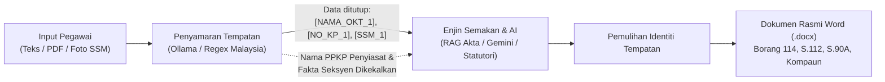

<div align="center">


<br /><br />


# i-UIP Nerus

**Platform Pintar Penguatkuasaan, Pengurusan Kertas Siasatan (IP), Semakan Pra-TPR & Notis Kompaun**  
*Unit Inspektorat dan Perundangan (UIP), Pejabat Kesihatan Daerah Kuala Nerus, Jabatan Kesihatan Negeri Terengganu*

> *"Satu Hati, Satu Tekad: Memacu Kecemerlangan Kesihatan Kuala Nerus"*

[](https://iuippkdkn.cloud.run)
[](frontend/package.json)
[](backend/requirements.txt)
[](backend/core/database.py)
[](backend/tests/test_uip_command.py)

[Aplikasi Web](https://iuippkdkn.cloud.run) • [Ciri Utama](#-ciri--modul-utama) • [Seni Bina Privasi](#-seni-bina-keselamatan--privasi-osa--pdpa) • [Panduan Pemasangan](#-menjalankan-secara-tempatan) • [Deploy Cloud Run](deploy/CLOUD_RUN_DEPLOY.md)

</div>

---

## Mengenai i-UIP Nerus

**i-UIP Nerus** ialah aplikasi web responsif (Desktop & Telefon Pintar) yang dibina khusus untuk membantu **Penolong Pegawai Kesihatan Persekitaran (PPKP)**, **Pegawai Kesihatan Persekitaran (PKP)**, dan **Pegawai Penyiasat (IO)** menjalankan tugasan penguatkuasaan kesihatan awam dengan lebih pantas, tepat, dan sifar kesilapan teknikal.

Aplikasi ini menggabungkan **enjin rujukan statutori tempatan** (berasaskan teks akta sebenar) bersama sokongan **AI Multimodal & Reasoning (Gemini)** serta **Penyamaran Data Peribadi (OSA 1972 & PDPA)** — memastikan fail Kertas Siasatan dan Notis Kompaun sentiasa kemas sebelum dikemukakan kepada **Timbalan Pendakwa Raya (TPR)** atau didaftarkan di **Mahkamah Majistret**.

---

## Ciri & Modul Utama

| Modul | Fungsi Utama Untuk Pegawai Lapangan & Pejabat |
| :--- | :--- |
| **1. Tanya Pakar UIP** | Rujukan pantas situasi di lokasi (*Tanya atau pilih daripada pustaka situasi lazim*) bagi mendapatkan **seksyen kesalahan, seksyen hukuman, keputusan Kompaun vs Buka IP, langkah SOP, eksibit wajib**, serta amaran kesilapan biasa — terus pindah ke Borang Kompaun atau Editor IP dalam 1 klik. |
| **2. Notis Kompaun** | Imbas foto **Sijil SSM / Notis** (atau tarik daripada kes aktif), isi borang berpandu, semak **10 perkara wajib** secara automatik *(MyKad 12 digit, had kompaun statutori cth. Akta 154 maks RM500, syarat saksi jika enggan tandatangan)*, dan muat turun **Notis Word (`.docx`)**. |
| **3. Semak Fail IP (Pra-TPR)** | Muat naik **PDF / Word IP, foto bukti, Carian SSM** atau catatan kes untuk **Audit 20 Kriteria Pra-TPR**: mengesan salah petik seksyen *(cth: S.38/S.44/P.30/Akta 514)*, percanggahan tarikh/masa, status Sijil 90A, semakan susunan fail **Bahagian A–G**, serta pratonton **Privasi Data (PDPA)**. |
| **4. Bina Fail IP & `.docx`** | Jana dan sunting terus dalam 4 bahagian kemas (*Pertuduhan & Saman*, *Minit, Fakta & Kronologi*, *Saksi, Eksibit & S.90A*, *Rakaman S.112 & Diari*). Eksport **Pakej Fail IP Penuh** atau dokumen individu (**Borang 114, Saman 111, Diari Siasatan, Rakaman S.112**) ke format rasmi Microsoft Word **`.docx`**. |
| **5. Buku Panduan & Cari Akta** | Rujukan digital 4 fasa operasi UIP, *Cheat Sheet* 4 akta teras, formula **5W1H Borang 114**, senarai **10 kesilapan maut PPKP**, serta enjin carian ayat akta rasmi (`ChromaDB` / BM25). |
| **6. Profil Pegawai SSPA & Daftar Kes** | Log masuk menggunakan **Google OAuth 2.0** atau emel rasmi, menyokong gred **SSPA** (`U5–U14`, `UD9–UD14`, `C9–C14`), auto-isi No. Kad Kuasa, Mahkamah Majistret & perkakasan Sijil 90A ke dokumen rasmi, berserta simpanan Daftar Kes PKD. |

---

## Pangkalan Data Akta Verbatim (`data/akta/`)

Semua jawapan statutori, semakan seksyen dan penjanaan pertuduhan disemak terhadap fail teks akta rasmi dalam [`data/akta/`](data/akta):

| Akta | Fail Rujukan | Skop Penguatkuasaan |
| :--- | :--- | :--- |
| **Akta 852** | [`akta_852_kawalan_produk_merokok_2024.txt`](data/akta/akta_852_kawalan_produk_merokok_2024.txt) | Akta Kawalan Produk Merokok Demi Kesihatan Awam 2024 (Pamer vape, iklan, OBD `<18`, kawasan larangan merokok) |
| **Akta 281** | [`akta_281_akta_makanan_1983.txt`](data/akta/akta_281_akta_makanan_1983.txt) | Akta Makanan 1983 & PPKM 2009 (Premis kotor S.11, Tifoid P.31, LPM P.30, Kompaun S.32B/S.33) |
| **Akta 154** | [`akta_154_pemusnahan_serangga_1975.txt`](data/akta/akta_154_pemusnahan_serangga_1975.txt) | Akta Pemusnahan Serangga Pembawa Penyakit 1975 (Pembiakan Aedes S.13, Perintah S.8, Kompaun S.25 maks RM500) |
| **Akta 342** | [`akta_342_penyakit_berjangkit_1988.txt`](data/akta/akta_342_penyakit_berjangkit_1988.txt) | Akta Pencegahan dan Pengawalan Penyakit Berjangkit 1988 (Kes Tibi cicir rawatan, ingkar perintah S.22/S.24) |
| **Akta 593** | [`akta_593_kanun_tatacara_jenayah.txt`](data/akta/akta_593_kanun_tatacara_jenayah.txt) | Kanun Tatacara Jenayah (KTJ) — Percakapan S.112, Diari Siasatan S.119, Saman S.111, Sanksi S.376, S.163 |
| **Akta 56** | [`akta_56_akta_keterangan_1950_s90a.txt`](data/akta/akta_56_akta_keterangan_1950_s90a.txt) | Akta Keterangan 1950 — Perakuan Dokumen Komputer / Gambar Digital Seksyen 90A(2) |

---

## Seni Bina Keselamatan & Privasi (OSA / PDPA)

Aplikasi ini direka supaya identiti Orang Kena Saman (OKS), saksi dan maklumat syarikat sentiasa dilindungi apabila pemprosesan awan digunakan:



* **Lapisan Privasi Automatik:** Jika **Ollama (`gemma3:12b`)** berjalan secara tempatan, ia digandingkan bersama **Regex Pintar Malaysia** untuk menutup Nama OKT/Saksi, No. K/P, Pasport, telefon, premis dan No. SSM sebelum sebarang analisis dijalankan.
* **Mod Luar Talian / Tanpa Kunci AI:** Jika `GEMINI_API_KEY` belum ditetapkan, sistem tetap beroperasi menggunakan **Enjin Statutori Tempatan** untuk semakan asas, carian akta, pengiraan kompaun, penyamaran data dan eksport `.docx`.
* **Kawalan Akses Pembangun:** Konsol Pembangun, Tetapan Sistem dan Arkib Bucket Persendirian (`dev-vault`) dikawal ketat oleh pengesahan pelayan untuk akaun pembangun berdaftar sahaja.

---

## Susunan Teknologi (*Tech Stack*)

* **Frontend:** Next.js 15 (`output: "standalone"`), React 19, TypeScript, Tailwind CSS v3, Lucide React
* **Backend API:** FastAPI, Uvicorn, Pydantic v2, PyMuPDF (`fitz`), `python-docx`, `httpx`
* **Enjin AI & RAG:** Google GenAI SDK (`gemini-decision-1`, `gemini-4-hydrogen`, `gemini-4-argon` / `gemini-2.5-flash`), ChromaDB + carian BM25, Ollama (`gemma3:12b`)
* **Pangkalan Data & Storan:** Sokongan dwi-mod **PostgreSQL (Neon)** untuk produksi Cloud Run atau **SQLite WAL** untuk pembangunan tempatan, serta storan objek serasi S3 (`Neon Object Storage` / storan tempatan)
* **Infrastruktur Produksi:** Container gabungan Multi-Stage Docker + Nginx Reverse Proxy (`PORT=8080`) sedia untuk Google Cloud Run

---

## Struktur Projek

```text
projek-uip/
├── backend/
│   ├── core/               # Konfigurasi (.env), pangkalan data SQLite/PostgreSQL, redactor & penghala model
│   ├── rag/                # Pengindeks & enjin carian akta verbatim (ChromaDB / BM25)
│   ├── services/           # Logik Pakar UIP, Auditor 20 Kriteria, Kompaun, Eksport .docx, Dev Vault
│   ├── tests/              # Suite ujian automatik Pytest (15 ujian teras & keselamatan)
│   └── main.py             # Pintu masuk REST API FastAPI
├── frontend/
│   ├── public/images/      # Aset logo rasmi i-UIP Nerus & PKD Kuala Nerus (KN2S)
│   └── src/
│       ├── app/            # Halaman utama, susun atur & gaya global (anti-zoom iOS & responsif)
│       ├── components/     # Komponen antaramuka Desktop & Mobile (Tanya Pakar, Kompaun, Editor IP, dll.)
│       └── lib/            # Klien API & takrifan jenis TypeScript
├── data/
│   └── akta/               # Teks rasmi 6 akta penguatkuasaan KKM
├── deploy/                 # Konfigurasi Nginx, skrip start.sh & panduan Google Cloud Run
├── training/               # Utiliti penyediaan set data & fine-tuning model tempatan
├── Dockerfile              # Binaan produksi 1-servis (Nginx + FastAPI + Next.js Standalone)
└── .env.example            # Templat pemboleh ubah persekitaran
```

---

## Menjalankan Secara Tempatan

### Prasyarat
* **Python 3.11+** (disyorkan menggunakan persekitaran maya `.venv`)
* **Node.js 20+** dan `npm`

### 1. Konfigurasi Persekitaran (`.env`)
Salin templat konfigurasi dan lengkapkan pemboleh ubah mengikut keperluan (sekurang-kurangnya `GEMINI_API_KEY` jika mahu mod AI aktif, dan `DATABASE_URL` jika menyambung ke PostgreSQL Neon):

```powershell
Copy-Item .env.example .env
```

### 2. Pasang Kebergantungan & Hidupkan Backend (FastAPI)

```powershell
# Bina persekitaran Python & pasang kebergantungan
python -m venv .venv
.\.venv\Scripts\python.exe -m pip install -r backend\requirements.txt

# Jalankan pelayan API pada port 8000
.\.venv\Scripts\python.exe -m uvicorn backend.main:app --reload --port 8000
```

### 3. Pasang Kebergantungan & Hidupkan Frontend (Next.js)

```powershell
cd frontend
npm install
npm run dev
```

Buka pelayar web di `http://localhost:3000`. Untuk mod produksi tempatan, jalankan `npm run build` diikuti `npm run start`.

---

## Ujian & Pengesahan Kualiti

Jalankan ujian automatik backend dan binaan frontend sebelum membuat deployment:

```powershell
# Ujian keseluruhan API, RAG akta, auditor IP, penjanaan .docx & kawalan akses
.\.venv\Scripts\python.exe -m pytest -v backend/tests/test_uip_command.py

# Pengesahan TypeScript & binaan produksi Next.js
Set-Location frontend; npm run build
```

---

## Deployment Produksi (Google Cloud Run & Neon PostgreSQL)

Projek ini siap untuk di-deploy sebagai **1 servis Cloud Run gabungan** menggunakan [`Dockerfile`](Dockerfile) dan [`deploy/start.sh`](deploy/start.sh) (Nginx menguruskan `/api/*` ke FastAPI dan `/*` ke Next.js tanpa isu CORS).

* Rujuk panduan langkah demi langkah lengkap di **[`deploy/CLOUD_RUN_DEPLOY.md`](deploy/CLOUD_RUN_DEPLOY.md)**.
* Pastikan `DATABASE_URL` (PostgreSQL Neon) ditetapkan di **Variables & Secrets** Cloud Run supaya rekod pengguna, kes dan Arkib Dev tersimpan kekal (bukan SQLite sementara dalam container). Sahkan di `/api/health` bahawa pelayan memulangkan `{"status":"ok","db":"postgres"}`.

---

## Penalaan Model Tempatan (Pilihan — `training/`)

Bagi fasiliti yang ingin melatih penyesuaian bahasa tempatan secara luar talian:

```powershell
.\.venv\Scripts\python.exe training\prepare_dataset.py --input-dir .\arkib_ip --output .\training\uip_dataset.jsonl
.\.venv\Scripts\python.exe training\finetune_unsloth.py --dataset .\training\uip_dataset.jsonl
```

---

<div align="center">

Dibangunkan oleh **[g.dev/syrzy](https://g.dev/syrzy)** untuk **Unit Inspektorat dan Perundangan (UIP)**  
**Pejabat Kesihatan Daerah Kuala Nerus, Terengganu**

</div>
